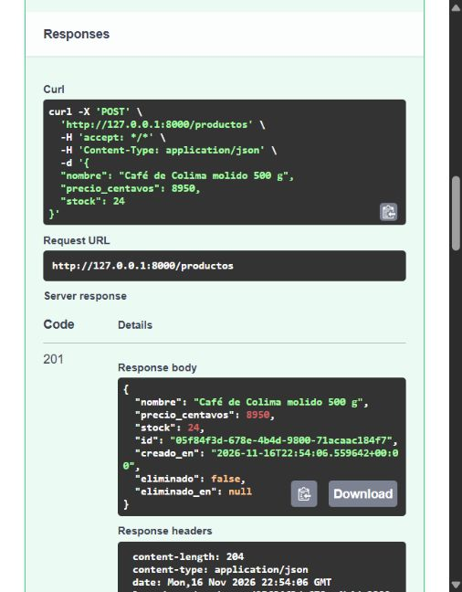
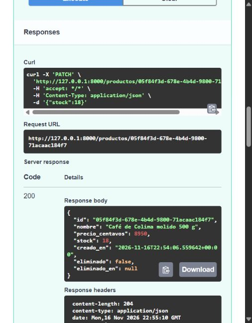
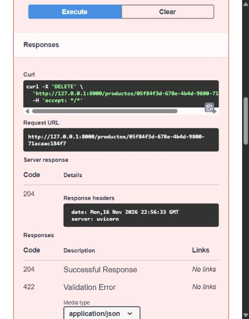
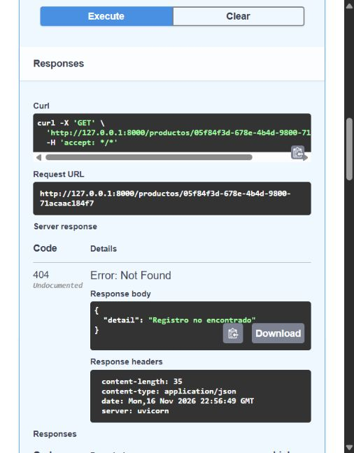

# Evidencias de ejecución · T3-01

**Oscar Emiliano Ramírez García · 23460525**  
**TÓPICOS DE BASE DE DATOS · TecNM Campus Colima**  
**Fecha de captura:** 16 de noviembre de 2026.

Esta ampliación documenta la aplicación existente. No cambia sus modelos, endpoints,
reglas de negocio ni configuración. La base del código probado es el commit `09df4a8`.
Los datos de clientes y productos son ficticios; las peticiones, las respuestas y las
consultas a los motores se ejecutaron realmente en el equipo local.

## Archivos para revisar

- [Reporte PDF con capturas y resultados](23460525_T3-01_Evidencias.pdf).
- [Transcripción HTTP completa](sesion-real/http-completo.txt): 39 peticiones con
  método, URL, cuerpo enviado, fecha, duración, código y respuesta.
- [Registro HTTP original en JSON Lines](sesion-real/http.jsonl): además conserva
  las cabeceras de respuesta.
- [Identificadores de la sesión](sesion-real/identificadores.json) y
  [resumen de resultados](sesion-real/resumen.json).
- [Consultas antes del borrado](sesion-real/antes-del-borrado) y
  [consultas después del borrado](sesion-real/despues-del-borrado).
- [Estado real de los contenedores](sesion-real/contenedores.txt).

## Capturas de Swagger

Las cuatro capturas corresponden al **mismo producto**:
`05f84f3d-678e-4b4d-9800-71acaac184f7`. Se guardaron directamente desde el navegador;
no se retocaron datos, códigos HTTP ni fechas. Los archivos de texto asociados
contienen el texto completo del bloque de operación, incluyendo URL y cabeceras.



Figura 1. Creación con 24 unidades y precio de 8950 centavos ($89.50 MXN).



Figura 2. El mismo producto se actualiza a stock = 18.



Figura 3. La API acepta el borrado lógico y responde sin cuerpo.



Figura 4. La consulta pública ya no recupera el registro.

[La consulta SQL posterior](sesion-real/05-postgresql-producto-swagger.txt) confirma
que ese mismo producto sigue almacenado, con `stock=18`, `eliminado=t` y
`eliminado_en=2026-11-16T22:56:34.098503+00:00`.

## Sesión automatizada de los seis recursos

Este recorrido usa **otro conjunto de IDs**. No debe confundirse con el producto
creado en Swagger. `identificadores.json` permite localizar cada registro exacto.

| Recurso | POST | GET | PATCH | DELETE | GET posterior |
|---|---:|---:|---:|---:|---:|
| clientes | 201 | 200 | 200 | 204 | 404 |
| productos | 201 | 200 | 200 | 204 | 404 |
| pedidos | 201 | 200 | 200 | 204 | 404 |
| resenas | 201 | 200 | 200 | 204 | 404 |
| carritos | 201 | 200 | 200 | 204 | 404 |
| preferencias | 201 | 200 | 200 | 204 | 404 |

Además se verificó que el ID borrado no estuviera en el GET de activos. La petición
20 obtuvo 422 al intentar crear un precio negativo; la 21 obtuvo 422 al intentar
cambiar el metadato `eliminado` mediante PATCH.

### Permanencia en los motores

Los archivos nativos incluyen fecha, comando ejecutado y salida completa:

- **PostgreSQL:** consultas `SELECT` desde `psql` a clientes y productos, antes y
  después; la fila no desaparece y su campo `eliminado` cambia de `f` a `t`.
- **MongoDB:** `findOne` desde `mongosh` a pedidos y reseñas. Los mismos documentos
  permanecen con `eliminado: true`.
- **Redis:** `GET`, `EXISTS` y `TTL` para carritos y preferencias. Tras DELETE la
  clave conserva el JSON marcado, `EXISTS` devuelve 1 y `TTL` devuelve -1.

La sesión automatizada comenzó a las 16:56:15, hora de Ciudad de México (UTC-6).
Las trazas y cabeceras usan UTC y muestran aproximadamente las 22:56.

## Reproducción e integridad

Para una nueva ejecución, conserve primero una copia de esta carpeta: el recolector
actualiza los archivos de `sesion-real`. Con el servicio levantado, desde la raíz
del repositorio y con Python 3.12 instalado:

```sh
python evidencias/recolectar.py
```

El recolector utiliza HTTP real y las herramientas `psql`, `mongosh` y `redis-cli`
dentro de los contenedores. Solo crea registros de demostración y aplica borrado
lógico a los IDs que él mismo crea. Las capturas de Swagger son una sesión aparte;
el recolector no las recrea ni las altera.

`SHA256SUMS.txt` registra las huellas de los archivos entregados. Desde esta carpeta,
en Linux/macOS puede verificar con `sha256sum -c SHA256SUMS.txt`. En PowerShell use
`Get-FileHash -Algorithm SHA256 ruta_del_archivo` y compare el resultado con la lista.
Las huellas permiten detectar cambios posteriores; no son una certificación externa.

## Alcance y origen

`pruebas.txt`, `demo.txt` y `persistencia.txt` conservan las comprobaciones anteriores
sin sobrescribirlas. No se presentan como si fueran parte de esta nueva sesión.
Cambiar un pedido a `pagado` solo actualiza un campo: no demuestra cobro externo ni
un descuento automático del stock. El repositorio continúa siendo local.

Se utilizó Codex de OpenAI para operar Swagger, ejecutar peticiones y consultas,
guardar capturas y salidas y redactar la explicación. El estudiante conserva la
responsabilidad de comprender y comprobar el proyecto. El PDF incluye referencias
IEEE y la declaración de uso de IA.
